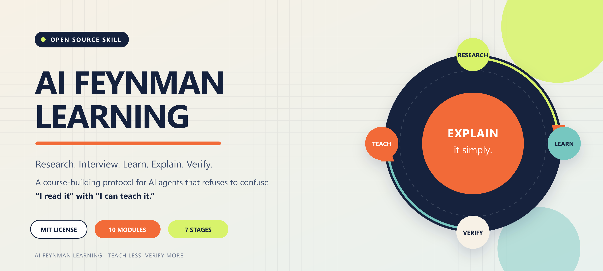
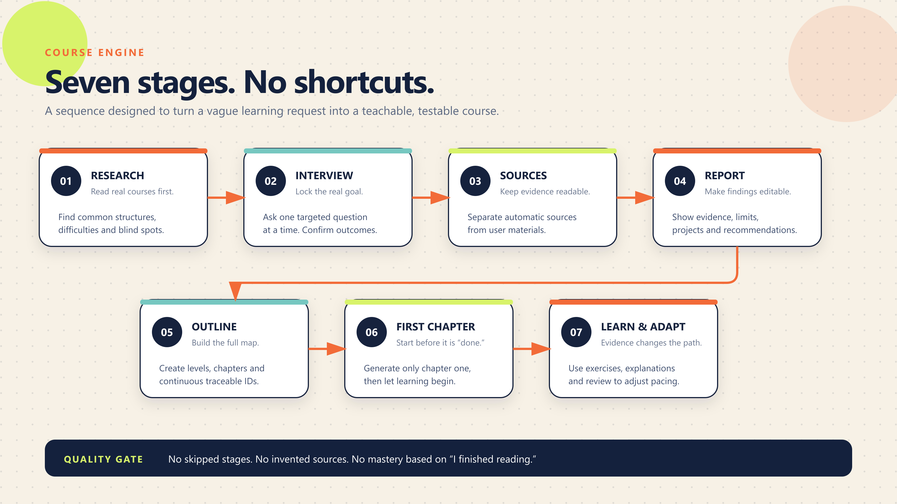
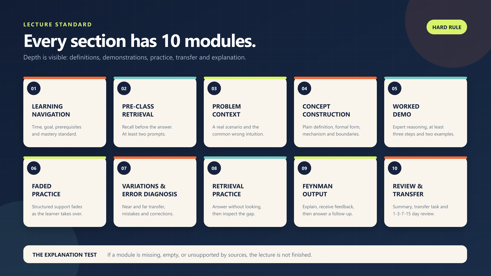

# AI Feynman Learning

[简体中文](README.md) | **English**

> A Feynman-technique learning skill for AI agents: research first, interview to lock the goal, verify sources and the report, build the course, learn chapter by chapter, and validate real understanding through exercises, Feynman explanations, and spaced review.

[](LICENSE)



## What This Is

This repository is a skill package that can be installed into Codex and other AI agents that support `SKILL.md`. It is not a standalone web application. It is an executable course-design and teaching protocol that tells an agent how to:

- Conduct preliminary research before asking questions, so the interview is specific to the subject;
- Ask one question at a time and first lock a measurable learning goal;
- Build research reports only from readable, traceable sources;
- Produce a continuous, non-duplicated course outline and level structure;
- Write lectures using the 10-module standard and test understanding through exercises and Feynman explanations;
- Adapt later lessons based on mistakes, blockers, and transfer performance.

Core principle: **If you cannot explain it simply to a layperson, you do not understand it well enough yet.**

## Core Modes

| Mode | Purpose |
| --- | --- |
| Course mode | Build a complete personalized course through preliminary research, a goal interview, and chapter-by-chapter learning |
| Examiner mode | Run progressive active-recall quizzes with per-question scoring, diagnosis, and follow-ups |
| Cheat-sheet mode | Generate a scannable one-page review resource |
| Resource-planning mode | Select the highest-value learning resources |
| Feynman deep-dive mode | Test genuine understanding through explanation, examples, and changed conditions |
| File-vault mode | Export a Markdown or Obsidian offline knowledge base |

## Visual Preview

These images also test PNG rendering, repository-relative paths, table layout, and responsive scaling in GitHub Markdown.

| Seven-stage workflow | 10-module lecture |
| :---: | :---: |
| [](assets/images/workflow.png) | [](assets/images/ten-modules.png) |

## Course Workflow

Course creation follows a fixed seven-stage workflow. Steps may not be skipped:

1. **Preliminary AI research**: Learn how the subject is currently taught, then form hypotheses about key points, difficulties, and interview questions.
2. **Targeted interview and goal lock**: Confirm the target depth, measurable outcome, schedule, and available study time.
3. **Source collection and user confirmation**: Separate automatic sources from user materials and retain only sources with readable text or a valid summary.
4. **Editable research report**: Generate the report from confirmed sources, then allow repeated revisions and saving.
5. **Course outline and structure**: Build a complete, continuous, traceable outline organized by levels, chapters, and sections.
6. **First-chapter lecture**: After the structure is confirmed, generate only the first chapter so learning can begin.
7. **Chapter-by-chapter learning**: Unlock later chapters in order and adapt the course based on quizzes, exercises, and Feynman explanations.

## The 10-Module Lecture

Every lecture section must include:

1. Learning navigation
2. Pre-class retrieval
3. Problem context
4. Concept construction
5. Complete worked demonstration
6. Faded practice
7. Variations and error diagnosis
8. Retrieval practice
9. Feynman explanation
10. Summary, transfer, and review

Exercises default to three four-option multiple-choice questions plus one open-ended question. After submission, the AI evaluates the answers and saves the response, feedback, gaps, and improvement suggestions.

## Installation

### Codex

Clone the repository into the Codex user skills directory:

```powershell
# Windows PowerShell
git clone https://github.com/Luminet-LT/ai-feynman-learning.git "$HOME\.codex\skills\feynman-learning"
```

```bash
# macOS / Linux
git clone https://github.com/Luminet-LT/ai-feynman-learning.git ~/.codex/skills/feynman-learning
```

Update an existing installation with:

```powershell
git -C "$HOME\.codex\skills\feynman-learning" pull
```

```bash
git -C ~/.codex/skills/feynman-learning pull
```

After installation, invoke the skill in Codex with `$feynman-learning`. If it does not appear immediately, reload or restart Codex.

### Other Agents

Copy the entire directory into the target agent's user skills directory and make sure `SKILL.md` is at the skill root. If the platform does not natively support Codex skills, use `SKILL.md` as a system prompt or workflow specification.

## Usage Examples

```text
Use $feynman-learning to help me learn probability systematically. My goal is to solve introductory modeling problems independently in one month.
```

```text
Use examiner mode in $feynman-learning to quiz me on Transformers, one question at a time.
```

```text
Use $feynman-learning to create a one-page linear algebra cheat sheet, verifying key definitions first.
```

```text
Use $feynman-learning to export my course as an Obsidian knowledge base.
```

## Repository Structure

```text
.
├── SKILL.md                    # Skill entry point and core teaching protocol
├── agents/
│   └── openai.yaml             # Agent interface metadata and default prompt
├── assets/
│   ├── course-template.md      # Course file template
│   └── images/                 # Cover, workflow and 10-module diagrams (SVG + PNG)
├── references/
│   ├── depth-spec.md           # Depth and quality specification
│   ├── levels.md               # Levels, mastery, and evaluation criteria
│   ├── modes.md                # Non-course teaching modes
│   └── obsidian-vault.md       # Offline knowledge-base structure
├── CONTRIBUTING.md
├── LICENSE
├── README.en.md
└── README.md
```

## Design Principles

- **Diagnose before teaching**: Never treat "I finished reading" as evidence of mastery.
- **Keep sources traceable**: Never fabricate page numbers, links, or textbook quotations; mark unverified material explicitly.
- **Teach in small steps**: Let the learner answer before revealing, evaluating, and filling gaps.
- **Advance using evidence**: Assign mastery levels based on answers, exercises, Feynman explanations, and transfer performance.
- **Generate progressively**: Do not dump an entire course at once; begin learning once the first chapter is ready.
- **Save context without dropping essentials**: Preserve learner answers, outline identifiers, and the core sources for the current chapter.

## Scope and Limitations

- This repository provides a skill definition and workflow, not a course database, web UI, or model API.
- Persistence of courses, reports, exercises, and feedback is provided by the host agent or platform.
- The skill requires web research for real sources. When full text is unavailable, it marks the limitation instead of inventing citations.
- AI teaching feedback supports learning; it does not replace formal assessment, examination results, or professional advice.

## Contributing

Issues and pull requests are welcome, especially for:

- Improvements to the teaching workflow and quality standards;
- New subject adaptations and counterexamples;
- Agent platform compatibility fixes;
- Documentation, templates, and source verification.

Read [CONTRIBUTING.md](CONTRIBUTING.md) before submitting a contribution. The contribution guide is currently written in Chinese.

## License

This project is open source under the [MIT License](LICENSE).
